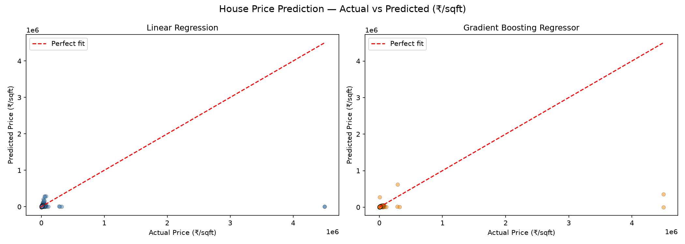
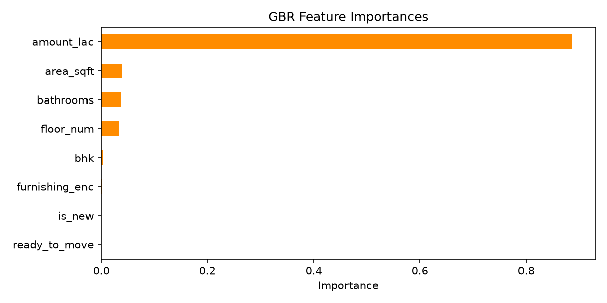

# 🏠 House Price Prediction using Linear Regression and GBR


A machine learning project that predicts **house prices per square foot** in Thane, India using **Linear Regression** and **Gradient Boosting Regressor (GBR)**.

---

## 📌 Overview

This project takes a real-world Indian real estate dataset (Thane region), cleans and engineers features from raw listing data, trains two regression models, and compares their performance.

---

## 📁 Project Structure

```
House Price Prediction using Linear Regg and GBR/
│
├── house_prices.csv              # Raw dataset
├── house_price_prediction.py     # Main ML script
├── requirements.txt              # Pinned Python dependencies
├── predictions_scatter.png       # Actual vs Predicted plot (both models)
├── feature_importance.png        # GBR feature importance chart
└── README.md
```

---

## 📊 Dataset

- **Source:** Real estate listings from Thane, India
- **Size:** ~1,87,531 rows × 21 columns
- **Key columns used:**
  - `Amount(in rupees)` — listing price (Lac / Cr)
  - `Carpet Area` / `Super Area` — property size in sqft
  - `Bathroom`, `Floor`, `Furnishing`, `Transaction`, `Status`
  - `Title` — used to extract BHK count
  - `Price (in rupees)` — **target** (price per sqft)

---

## ⚙️ Features Engineered

| Feature | Description |
|---|---|
| `bhk` | Number of bedrooms (extracted from title) |
| `area_sqft` | Carpet area (fallback: super area) |
| `floor_num` | Current floor number |
| `bathrooms` | Number of bathrooms |
| `furnishing_enc` | 0 = Unfurnished, 1 = Semi, 2 = Furnished |
| `is_new` | 1 = New Property, 0 = Resale |
| `ready_to_move` | 1 = Ready to Move, 0 = Under Construction |
| `amount_lac` | Total listing price converted to Lakhs |

---

## 🤖 Models Used

### 1. Linear Regression
- Baseline model from `sklearn.linear_model`
- Assumes a linear relationship between features and target

### 2. Gradient Boosting Regressor (GBR)
- Ensemble model from `sklearn.ensemble`
- Parameters: `n_estimators=200`, `learning_rate=0.05`, `max_depth=4`
- Captures non-linear patterns in the data

---

## 📈 Results

| Model | MAE (₹/sqft) | RMSE (₹/sqft) | R² Score |
|---|---|---|---|
| Linear Regression | 2,195.20 | 35,778.67 | 0.0007 |
| **Gradient Boosting (GBR)** | **922.61** | **34,254.21** | **0.0840** |

> **GBR significantly outperforms Linear Regression** — MAE is ~2.4× lower and R² is ~84× higher.

---

## 🖼️ Output Plots

### Actual vs Predicted


### GBR Feature Importances


---

## 🚀 How to Run

1. **Clone the repository**
   ```bash
   git clone https://github.com/anay-sinha/house-price-prediction.git
   cd house-price-prediction
   ```

2. **Install dependencies**
   ```bash
   pip install -r requirements.txt
   ```

3. **Run the script**
   ```bash
   python house_price_prediction.py
   ```

4. Output metrics will be printed to the terminal and plots saved as PNG files.

---

## 🛠️ Requirements

| Package | Version |
|---|---|
| pandas | >= 3.0.1 |
| numpy | >= 2.3.5 |
| scikit-learn | >= 1.9.1 |
| matplotlib | >= 3.11.2 |

Install all at once:
```bash
pip install -r requirements.txt
```

---

## 👤 Author

**anay-sinha**  
GitHub: [@anay-sinha](https://github.com/anay-sinha)

---

## 📄 License

This project is open source and available under the [MIT License](LICENSE).
